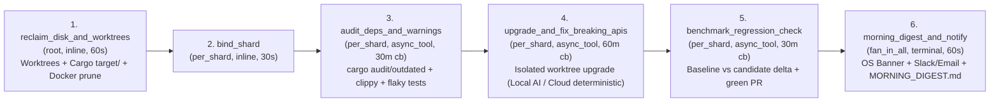

# Scheduled Overnight Repo Hygiene & Dependency Upgrader (`rippflow-nightwatch`)

A scheduled overnight repository hygiene, disk-reclamation, dependency-upgrading, benchmark-gating, and morning PR digest workflow (`rippflow-nightwatch`) built for both **local workstations** (`--rippflow-env local`) and **cloud / CI runners** (`--rippflow-env cloud`, zero Codex/Gemini dependencies).

Trigger it nightly via **cron** or `/schedule` hitting your persistent local HTTPS endpoint:
`POST https://localhost:<port>/v1/workflows/rippflow-nightwatch/run`

---

## What It Cleans & Upgrades Overnight

1. **Workspace Disk & Worktree Hygiene (`reclaim_disk_and_worktrees` — `root`, `60s`):**
   - **Stale Git Worktrees:** Runs `git worktree prune` and removes clean linked git worktrees older than `staleWorktreeHours` (default `24h`) while **never** touching your primary checkout or any worktree with uncommitted edits!
   - **Cargo `target/` Reclamation:** Cleans Rust `target/` and `.cargo-target-*` directories across shards (`cargo clean` / safe removal) with exact reclaimed byte accounting.
   - **Docker Image & Builder Cleanup:** Runs `docker image prune -af --filter until=72h` and `docker builder prune -f --filter until=72h` when the local Docker daemon is reachable (automatically skipped when `RIPPFLOW_ENV=cloud`).
2. **Audit Dependencies, Warnings & Flaky Tests (`audit_deps_and_warnings` — `per_shard`, `async_tool`):**
   - Security advisories (`cargo audit --json` / `npm audit --json`).
   - Outdated dependencies (`cargo outdated` / `pip list --outdated` / `npm outdated`).
   - Compiler & linter warnings (`cargo check --message-format=json` / Python warning checks).
   - **Multi-pass Flaky Test Detector:** Runs test suites `N` times (`flakyTestRuns`) to isolate intermittent/flaky test cases vs deterministic failures, and records baseline benchmark latency.
3. **Isolated Worktree Upgrade & Breaking-API Adaptation (`upgrade_and_fix_breaking_apis` — `per_shard`, `async_tool`):**
   - Applies manifest/lockfile version bumps inside isolated `.runs/<id>/worktrees/<shard>` branches.
   - **`--rippflow-env local`:** If post-upgrade tests or warnings fail, optionally invokes Gemini (`google-antigravity`) or Codex (`codex exec --full-auto`) to adapt breaking API call sites.
   - **`--rippflow-env cloud`:** AI tools are strictly flagged **OFF** (`deterministic:cloud-safe`, zero AI packages required).
4. **Benchmark Regression Gate (`benchmark_regression_check` — `per_shard`, `async_tool`):**
   - Compares candidate latency against pre-upgrade baseline (`maxBenchmarkRegressionPct`, default `5.0%`), cleans temporary `.cargo-target-<shard>` directories so overnight runs stay disk-neutral, and opens/stages ready-to-merge green PRs (`gh pr create` in `live` mode).
5. **Morning Digest & Notification (`morning_digest_and_notify` — `fan_in_all`, `terminal`):**
   - Generates `MORNING_DIGEST.md` + `digest.json` summarizing GBs reclaimed, advisories, flaky tests, benchmark deltas, and **ready-to-merge green PR links**, firing a native macOS/Linux/Windows banner (`local`) + Slack/email webhooks (`local` & `cloud`).

---

## Workflow DAG (`6 Phases`)



---

## Quickstart & Nightly Scheduling

### 1. Install & Validate

```bash
cd examples/nightwatch

python3 -m venv .venv
.venv/bin/pip install --upgrade pip
.venv/bin/pip install -e ".[dev]"

cp .env.example .env

rippflow validate workflow.yaml --handlers handlers.json --rippflow-env local
rippflow validate workflow.yaml --handlers handlers.json --rippflow-env cloud
rippflow controls validate workflow.yaml
```

### 2. Start Persistent Local HTTPS Endpoint (`:8445`) & Schedule Nightly Cron (`02:00`)

```bash
# Start persistent local HTTPS server
rippflow deploy --local workflow.yaml \
  --port 8445 \
  --rippflow-env local \
  --shards rippflow-core,rippflow-cli,rippflow-starter
```

Trigger from **crontab** (e.g. `0 2 * * *` at 2:00 AM every night) or via `/schedule`:

```cron
0 2 * * * curl -sk -X POST https://localhost:8445/v1/workflows/rippflow-nightwatch/run -H "Authorization: Bearer $RIPPFLOW_LOCAL_TOKEN" -H "Content-Type: application/json" -d @/path/to/nightwatch_input.json
```

---

## Running Tests

```bash
.venv/bin/pytest -v
```
