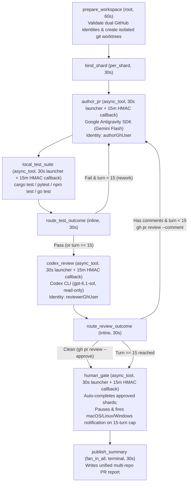

# Rippflow Multi-Repo AI Feature & Dual-Identity PR Review Pipeline

A local-first [Rippflow](https://rippflow.com) workflow that takes a natural-language feature request and a list of repositories, authors pull requests in isolated git worktrees, runs each repository's local test suite, conducts automated code review under a **separate GitHub identity**, iterates up to **15 turns**, and escalates unresolved shards to a human reviewer via **multi-OS desktop notifications** + **Rippflow authenticated HTTPS async callbacks**.

---

## Architecture

All external LLM (`author_pr`, `codex_review`), test-runner (`local_test_suite`), and human-review (`human_gate`) phases use Rippflow's canonical `type: async_tool` + authenticated `scoped_token_hmac` callback model:
- Every handler invocation finishes in milliseconds (`timeoutSeconds: 30`–`60`, `default_group: python-light`) and releases worker capacity immediately (`workerCapacityReleased: true`).
- Detached background workers run the external LLM / test suites with zero handler timeout pressure and POST an authenticated HMAC callback (`AsyncCallbackPayload`) to resume the workflow, while lightweight `< 50ms` inline routers (`route_test_outcome`, `route_review_outcome`) drive declarative `rework` loops (`max_loops: 14`).



---

## Key Capabilities

1. **Parallel Per-Repo Sharding (`per_shard` -> `fan_in_all`)**
   - Every target repository gets its own disposable git worktree under `.runs/<request_id>/worktrees/<repo>` so your main working copies remain untouched.
   - Multi-turn agent sessions (`SessionContinuationMode.CREATE_OR_RESUME`) preserve per-repo reasoning across rework loops.
2. **Strict Dual-Identity GitHub Isolation**
   - **`author_pr`** runs strictly with `GH_TOKEN=$(gh auth token --user <authorGhUser>)` and configures `commit.gpgsign=false` per worktree unless `authorSigningKey` is explicitly provided (preventing host SSH signing key mismatches).
   - **`codex_review`** runs strictly in read-only sandbox mode (`codex exec -s read-only`) with `GH_TOKEN=$(gh auth token --user <reviewerGhUser>)` to post review comments (`gh pr review --comment`) or approve (`gh pr review --approve`).
   - Both accounts cannot be identical in `live` mode (enforced at `prepare_workspace` admission).
3. **Hard 15-Turn Rework Cap (`maxTurns: 15` / `max_loops: 14`)**
   - Failing local tests loop directly back to `author_pr` without burning a reviewer turn.
   - Review comments loop back to `author_pr` up to turn 15, then escalate deterministically to `human_gate`.
4. **Multi-OS Desktop Notifications + Authenticated HTTPS Callback Pause**
   - Zero-dependency cross-platform notifier (`src/pr_pipeline/notify.py`):
     - **macOS (`darwin`)**: `terminal-notifier` (click-to-open PR URL) -> `osascript` native banner + alert sound
     - **Linux (`linux`)**: `notify-send` -> `gdbus` (`org.freedesktop.Notifications`) -> `kdialog`
     - **Windows (`win32`)**: PowerShell WinRT `ToastNotificationManager` -> WinForms `NotifyIcon` balloon
     - **Headless / SSH / Terminal fallback**: OSC 9 terminal notification escape sequence + `.runs/<id>/escalations/notifications.jsonl`
   - Pauses the escalated shard on Rippflow's `async_tool` callback (`workerCapacityReleased: true`) until resolved via `scripts/resolve_gate.py`.

---

## Quickstart

### 1. Install Dependencies

```bash
python3 -m venv .venv
.venv/bin/pip install --upgrade pip
.venv/bin/pip install -e ".[dev]"
```

Verify both GitHub accounts are logged into `gh`:

```bash
gh auth status
```

### 2. Configure `.env` (Identities & Workspace Path)

Copy `.env.example` to `.env` (gitignored) so your workspace directory, GitHub accounts, and model names are picked up automatically without hardcoding them in workflow payloads:

```bash
cp .env.example .env
# Edit .env with WORKSPACE_DIR, AUTHOR_GH_USER, AUTHOR_GIT_EMAIL, and REVIEWER_GH_USER
```

### 3. Validate Workflow & Policy Contracts

```bash
rippflow validate workflow.yaml --handlers handlers.json --json
rippflow controls validate workflow.yaml --json
```

### 4. Run Locally (`rippflow run`) or as a Persistent Local Service (`rippflow deploy --local`)

With `.env` configured, workflow input payloads only need `featureRequest` and `repos`:

```bash
cp examples/input.example.json input.local.json

# Persistent HTTPS endpoint + async callback server (supports 2h+ durable runs):
rippflow deploy --local workflow.yaml --shards service-core,service-cli

# Inspect live server & run diagnostics at any time:
rippflow deploy --server --logs
```

When a repository hits the 15-turn limit, you will receive a native OS notification and the shard will pause awaiting callback while releasing worker capacity. Inspect and resolve pending human escalations at any time:

```bash
# List paused 15-turn escalations
python3 scripts/resolve_gate.py --list

# Approve and resume the paused Rippflow shard
python3 scripts/resolve_gate.py --shard service-core --decision approve --note "Reviewed manually and merged"

# Or reject/abort the escalated shard
python3 scripts/resolve_gate.py --shard service-core --decision reject --note "Needs architectural redesign"
```

---

## Running the Test Suite

```bash
.venv/bin/pytest -v
```

---

## License

MIT — see [LICENSE](./LICENSE).
