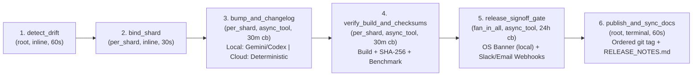

# Multi-Repo Release & Sync Train (`local` + `cloud`)

A hybrid **local + cloud** Rippflow workflow (`multi-repo-release-train`) that coordinates version bumps, cross-repo pinned commit SHA updates (`PINNED_SOURCE_SHAS.json`), changelog synthesis, parallel build + SHA-256 checksum & benchmark verification, a **human release sign-off gate** (`24h` durable suspension with zero worker capacity held), and ordered tag/publish + `RELEASE_NOTES.md` sync across dependent repositories.

## Cloud-Ready by Design (`RIPPFLOW_ENV=cloud`)

This workflow runs identically in **local developer workstations** (`--rippflow-env local`) and **air-gapped CI / AWS Lambda cloud cells** (`--rippflow-env cloud`) with **zero runtime dependency on Codex or Gemini**:

| Capability | `--rippflow-env local` (Default) | `--rippflow-env cloud` (CI / AWS Lambda) |
| :--- | :--- | :--- |
| **Base Python Dependencies** | Python 3.11+ stdlib (`.[local-ai]` optional) | **Zero external packages** (100% Python stdlib) |
| **Changelog Synthesis** | Gemini (`google-antigravity`) or Codex (`codex exec`), auto-fallback to deterministic | **AI strictly flagged OFF** (`deterministic:cloud-safe` Conventional-Commit parser) |
| **Sign-Off Notifications** | Native macOS/Linux/Windows OS banner **+** Slack/email webhooks | Skips desktop GUI binaries; delivers **Slack + email HTTPS webhooks** + JSON audit log |
| **Async Callback Ingress** | Local HTTPS `scoped_token_hmac` (`POST /callback`) | Local HTTPS `POST /callback` **or** AWS Lambda `boto3.client("lambda").invoke` |
| **State Root** | `./.runs/<request-id>/` | `./.runs/<request-id>/` or `/tmp/rippflow-release-train/.runs/` on read-only `/var/task` |

---

## Workflow DAG (`6 Phases`)



All handler slices execute in **`30s`–`60s`** (`python-light` / `python-standard`), releasing Rippflow worker capacity (`workerCapacityReleased: true`) while builds or human release approvals are in flight.

---

## Quickstart

### 1. Setup

```bash
cd examples/release-train

python3 -m venv .venv
.venv/bin/pip install --upgrade pip

# Cloud / CI install (zero AI dependencies):
.venv/bin/pip install -e ".[dev]"

# Optional local-only Gemini SDK support:
# .venv/bin/pip install -e ".[dev,local-ai]"

cp .env.example .env
```

### 2. Validate Both `local` and `cloud` Handler Profiles

```bash
rippflow validate workflow.yaml --handlers handlers.json --rippflow-env local
rippflow validate workflow.yaml --handlers handlers.json --rippflow-env cloud
rippflow controls validate workflow.yaml
```

### 3. Run in Cloud Mode (`--rippflow-env cloud` — Codex/Gemini Flagged Off)

```bash
rippflow run workflow.yaml \
  --handlers handlers.json \
  --rippflow-env cloud \
  --shards service-core,service-starter,service-docs \
  --input examples/release_input.example.json
```

### 4. Inspect & Approve (or Reject) the Human Release Sign-Off Gate

While `release_signoff_gate` is suspended awaiting sign-off, inspect or resolve it from another terminal (or wire your Slack approval bot to invoke the same authenticated callback):

```bash
# List pending release sign-off gates
python3 scripts/resolve_release_gate.py --list

# Approve -> resumes workflow into ordered `publish_and_sync_docs`
python3 scripts/resolve_release_gate.py \
  --run-id <RUN_ID> \
  --decision approve \
  --approver release-lead \
  --note "Checksums and benchmarks verified"

# Or reject -> aborts release cleanly before any tags are published
python3 scripts/resolve_release_gate.py \
  --run-id <RUN_ID> \
  --decision reject \
  --note "Hold train for patch"
```

### 5. Deploy Persistent Local HTTPS Ingress Server

```bash
# Run persistent local server with cloud-tier rules enforced
rippflow deploy --local workflow.yaml \
  --rippflow-env cloud \
  --shards service-core,service-starter,service-docs

# Stream redacted server & run logs
rippflow deploy --server --logs --follow
```

---

## AWS Cloud Lambda Entrypoint

For deployed Rippflow Cloud cells, point your Lambda handler at `release_train.cli_entry.lambda_handler`. It automatically defaults `RIPPFLOW_ENV=cloud`, handles both synchronous inline phases (`detect_drift`, `bind_shard`, `publish_and_sync_docs`) and `aws_lambda` `async_tool` Event adapters, and posts `SUCCEEDED` / `FAILED` callbacks via `boto3.client("lambda").invoke` with `InvocationType="RequestResponse"`.

---

## Running Tests

```bash
.venv/bin/pytest -v
```
